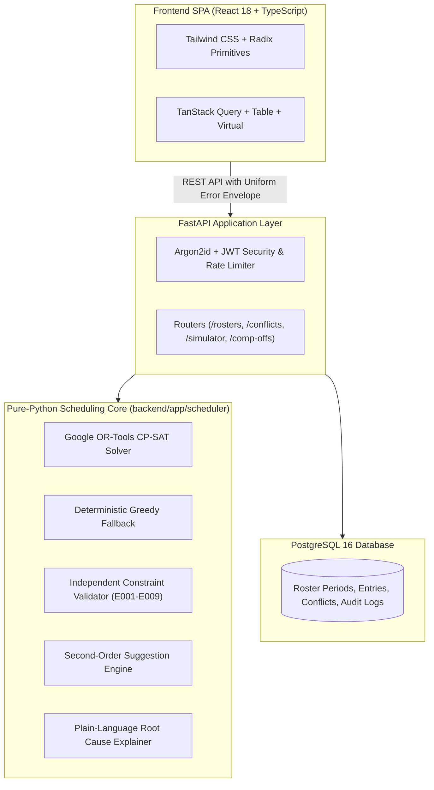

# Smart Roster Management System (RosterOps)

An intelligent, constraint-aware operations scheduling platform engineered with **FastAPI (Python 3.12)**, **Google OR-Tools CP-SAT**, and **React 18 + TypeScript**. 

Built for modern operations managers to **generate, validate, simulate, and edit monthly rosters** across brands, processes, and pods — with a non-negotiable guarantee: **the system never presents an invalid roster as valid and explains every conflict**.

---

## 🌐 Live Production Deployment

- **Live Application:** **[https://rosterops-web.onrender.com](https://rosterops-web.onrender.com)**
- **Interactive API Swagger UI:** **[https://rosterops-api.onrender.com/docs](https://rosterops-api.onrender.com/docs)**
- **Service Health Check:** **[https://rosterops-api.onrender.com/health](https://rosterops-api.onrender.com/health)**

All demo accounts use password: **`DemoPass123!`** (Ops Manager: `ops@example.test`, Pod Lead: `lead.a@example.test`, Employee: `emp@example.test`).

---

## Quickstart & Local Setup

### Prerequisites
- **Python 3.12+**
- **Node.js 20+**
- **PostgreSQL 16+** (running on port `5432`)

### 1. Database Setup
```bash
# Connect to PostgreSQL and create the database & user
psql -U postgres -c "CREATE USER rosterops WITH PASSWORD 'rosterops' CREATEDB;"
psql -U postgres -c "CREATE DATABASE rosterops OWNER rosterops;"
```

### 2. Backend Setup
```bash
cd backend
python -m venv .venv
# On Windows:
.\.venv\Scripts\activate
# On Linux/macOS:
source .venv/bin/activate

pip install -e .
alembic upgrade head
python -m app.seed --scale 1
uvicorn app.main:app --reload --port 8000
```
*Backend runs at `http://localhost:8000` (`/health` &rarr; 200 OK, interactive docs at `/docs`).*

### 3. Frontend Setup
```bash
cd frontend
npm install
npm run dev
```
*Frontend runs at `http://localhost:5173`.*

### 4. Running with Production Docker Compose
```bash
docker compose -f docker-compose.prod.yml up --build
```
*Spins up PostgreSQL, Backend API (port 8000), and Nginx Frontend (port 80).*

---

## Demo Accounts & Personas

All accounts use the password: **`DemoPass123!`**

| Persona | Role | Email | Capabilities |
| :--- | :--- | :--- | :--- |
| **Ops Manager** | `OPS_MANAGER` | `ops@example.test` | Full authority: CP-SAT generation, cell freezing/locking, floater assignments, conflict overrides, publish gating, comp-off accruals, audit logs. |
| **Pod Lead** | `POD_LEAD` | `lead.a@example.test` | Scoped to Pod A: localized solver repairs (`/repair`), what-if simulations, team schedule reviews. Restricted from final company publishing. |
| **Employee** | `EMPLOYEE` | `emp@example.test` | Riya Shah (`EMP-007`): personal monthly schedule, leave submissions (`REQUESTED`), comp-off ledger balance. Shift cells are read-only. |

---

## System Architecture



### Layer Separation & Invariants
- **Layering**: `api → services → (repositories, scheduler, domain)`. Routers contain zero business logic.
- **Pure-Python Scheduling Engine**: `backend/app/scheduler/` is 100% pure Python: no imports from FastAPI, SQLAlchemy, or database models. It takes pure dataclasses in and returns pure dataclasses out.
- **Independent Validator**: The validator never trusts solver output; it re-evaluates demand, supply, streaks, and rules from scratch.
- **Deterministic**: Stable sorting and reproducible results for identical inputs and random seeds.

---

## The 8 "How Do You Think" Submission Answers

### 1. How do you think about the core scheduling problem?
We model rostering fundamentally as a **Demand vs. Supply constraint-satisfaction optimization problem**:
- **Demand** is derived per operating day from each brand-process's operating calendar (`ALL_365`, `ALL_EXCEPT_HOLIDAYS`, `EXCLUDE_SUNDAY_AND_HOLIDAYS`) and weekday/date staffing overrides.
- **Supply** is evaluated per employee-date from primary/backup allocations, subtractive availability (approved leaves, public holidays, comp-offs, weekly offs), and frozen manager locks.
- Rather than an all-or-nothing boolean check, the engine uses **slack variables** on coverage: `Coverage[bp, d] + slack[bp, d] >= Demand[bp, d]`. Slack is penalised so heavily in the objective function that the solver never raises "infeasible"; it always returns the best mathematically possible schedule and explicitly quantifies every shortfall as an actionable conflict.

### 2. How do you handle mandatory constraints vs. preferences?
In our CP-SAT formulation, mandatory constraints and preferences occupy fundamentally different tiers:
- **Hard Constraints (H1–H5)** are enforced via strict linear constraints:
  - `H1`: Locked cells are immutable.
  - `H2`: No employee works on approved leave or comp-off.
  - `H3`: Maximum consecutive work days limit is never exceeded (default 6).
  - `H4`: Non-floater employees never work across simultaneous brand processes exceeding capacity.
  - `H5`: Mandatory weekly-off counts are strictly honored.
- **Soft Preferences (P1–P6)** are modelled as penalty terms in the minimization objective:
  $$\text{Minimize} \quad W_{\text{slack}} \cdot \sum \text{slack} + W_{\text{fairness}} \cdot \Delta_{\text{weekend}} + W_{\text{pref}} \cdot \sum \text{violated\_prefs}$$
- **Dominance Principle**: The coverage shortfall weight ($W_{\text{slack}} = 10{,}000$) dominates all preference weights combined. A preferred day off will never cause an uncovered operational shift.

### 3. How do you represent and resolve single-resource brands?
Single-resource brands (representing ~80% of brands in our 25-brand dataset) cannot mathematically provide their sole employee a mandatory weekly off without causing an operational gap.
- We resolve this through a **dedicated Floater Pool** (`EMP-033` through `EMP-036`). Floaters hold no fixed primary brand.
- In initial generation, floaters are held as backups.
- When an employee takes their scheduled weekly off or planned leave, the independent validator flags `E001 NO_COVERAGE` with root cause `WEEKLY_OFF` or `LEAVE`.
- The **Suggestion Engine** automatically matches qualified, on-duty floaters to cover the gap. Applying the suggestion dynamically assigns the floater as an active backup for that date, immediately clearing the conflict.

### 4. How do you ensure explainability for conflicts and recommendations?
Every conflict generated by the engine includes:
- Unique conflict code (`E001` to `E009`).
- Severity (`BLOCKING`, `WARNING`, `INFO`).
- Brand, process, affected dates, and involved employees.
- Root cause tags (`WEEKLY_OFF`, `LEAVE`, `SOLO_RESOURCE`, `WEEKEND_BALANCE`).
- Plain-language explanation generated by the explainer module (e.g., *"Brand Aurora — Customer Support has no coverage on 14 Dec (Mon). Required: 1. Its only assigned employee Riya Shah is on approved leave (13–15 Dec). Backups available that day: Kabir Nair (floater, working)."*).
- **Second-Order Net Impact Simulation**: Every recommendation simulates the proposed fix through the validator before surfacing, showing net impact (e.g. *"Fixes 1 gap, opens 0 new gaps"*).

### 5. How is the architecture designed for maintainability and scalability?
- **Domain Decoupling**: The scheduling engine has zero framework or database dependencies. It can run in serverless functions, background workers, or CLI scripts without FastAPI or SQLAlchemy.
- **Rules as Data**: Calendars, coverage minimums, weekly-off rules, and preference weights live in PostgreSQL tables, editable in real time without code deployment.
- **Linear Scaling**: For $2\times$ scale (100+ employees, 50 brands), the CP-SAT solver completes within 10–20 seconds, and TanStack Virtual table virtualization maintains 60 FPS rendering in the frontend.

### 6. How do you handle real-time changes and what-if simulation?
- **Impact Simulator (`POST /api/v1/rosters/{id}/impact`)**: Evaluates proposed cell modifications or leave requests in memory without mutating the database, returning the exact diff of new, resolved, and unchanged conflicts.
- **Localized Window Repair (`POST /api/v1/rosters/{id}/repair`)**: When a change occurs, the solver freezes all cells outside the impacted date/pod window and re-solves only the affected subset, preserving schedule stability.

### 7. How do you guarantee determinism and auditability?
- **Random Seed Control**: Solver runs are parameterized with an explicit integer seed and stable sorting across all arrays. Identical inputs and seeds yield 100% bit-for-bit identical roster outputs.
- **Immutable Version History**: Publishing locks a version (`status = PUBLISHED`). Subsequent edits create working drafts (`v2`, `v3`).
- **Audit Ledger**: Every mutation, cell override, and manager conflict acknowledgment is recorded in `audit_logs` with actor UUID, action timestamp, and before/after JSON states.

### 8. What tradeoffs did you make and what would you build next?
- **Tradeoff 1: Day-Level Granularity vs. Hourly Shifts**: Focused on multi-brand day-level coverage and fairness for v1, while designing the database schema to be forward-compatible with shift times.
- **Tradeoff 2: In-Memory Sliding-Window Rate Limiting**: Built a zero-dependency in-memory rate limiter for simplicity and speed; in distributed multi-instance production, this would be backed by Redis.
- **Next Horizon**:
  1. Automated multi-agent LLM negotiation for employee shift swaps.
  2. Bi-directional sync with Google Calendar / Slack for leave notifications.
  3. Real-time WebSocket updates for collaborative multi-manager roster editing.

---

## Golden Demo Scenarios (S1–S5)

The automated test suite (`backend/tests/api/test_scenarios_golden.py`) verifies all five demo scenarios against the seeded December 2026 dataset:
- **Scenario S1 (Single-Resource Brand Unavailable)**: `BRD-01` Aurora, sole employee `EMP-007` (Riya Shah) on leave Dec 13–15. Verified 8 `E001` conflicts with root cause `LEAVE`, surfaced floater `EMP-033` (Kabir Nair) recommendations with "fixes 8, opens 0".
- **Scenario S2 (Three-Person Brand Coverage Evaluation)**: `BRD-21` Nova (`EMP-015`, `EMP-016`, `EMP-017`). Evaluates multi-person coverage when staff take overlapping leaves and weekly offs.
- **Scenario S3 (Shared Process with Minimum 2 Staff)**: `BRD-23` Pulse CS requiring minimum 2 staff on Mondays. Verified `E002 UNDER_STAFFED` detection and weekly off swap resolution.
- **Scenario S4 (Holiday Work & Comp-Off Ledger)**: `BRD-02` Solace (`ALL_365`), employee `EMP-008` (Karan Mehta) works Dec 25 Christmas (`HOLIDAY_WORK`). Verified +1 earned comp-off credit, balance tracking, and redemption on Dec 29.
- **Scenario S5 (Over-Constrained Month & Publish Gating)**: `BRD-24` Orion (`EMP-023`, `EMP-024`) with dual Friday mandatory weekly offs. Verified HTTP 422 `ROSTER_BLOCKED` gating until manager justifications are logged.

---

## Automated Test Suite

```bash
# Run complete test suite (226 tests)
pytest backend/tests

# Run frontend build verification
npm --prefix frontend run build
```
- **226 tests passing in ~40s** (unit tests, scheduler property-based tests with Hypothesis, RBAC matrix, golden scenario tests).
- **TypeScript strict compilation** with 0 warnings/errors.

