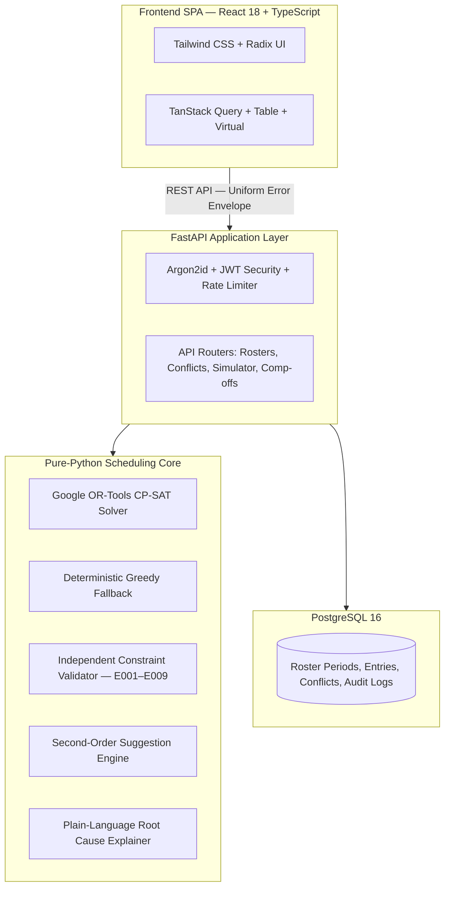

# RosterOps — Smart Roster Management System

**An intelligent, constraint-aware workforce scheduling platform**

RosterOps is a workforce scheduling platform designed to help operations teams generate, validate, simulate, and manage monthly employee rosters across multiple brands, processes, and pods.

The platform combines **FastAPI (Python 3.12)**, **Google OR-Tools CP-SAT**, and **React 18 with TypeScript** to solve complex staffing constraints while maintaining schedule transparency and operational reliability.

> **Core principle:** RosterOps never presents an invalid roster as valid. Every detected scheduling conflict is identified, explained, and made actionable.

---

## 1. Live Deployment

| Resource | Link |
|---|---|
| Production application | [Open RosterOps](https://rosterops-web.onrender.com) |
| Interactive API documentation | [Swagger UI](https://rosterops-api.onrender.com/docs) |
| API health check | [Health endpoint](https://rosterops-api.onrender.com/health) |
| Product walkthrough | [Watch the demo video](https://drive.google.com/file/d/1CgaYl3Nw7C4FywWsiK6Pp96d0_OKQzSv/view?usp=sharing) |

### Demo access

All demo accounts use the password `DemoPass123!`.

| User type | Email | Role |
|---|---|---|
| Operations Manager | `ops@example.test` | `OPS_MANAGER` |
| Pod Lead | `lead.a@example.test` | `POD_LEAD` |
| Employee | `emp@example.test` | `EMPLOYEE` |

The employee demo account represents **Riya Shah (EMP-007)**.

---

## 2. Technology Stack

| Layer | Technologies |
|---|---|
| Frontend | React 18, TypeScript |
| UI | Tailwind CSS, Radix UI primitives |
| Data fetching and state | TanStack Query |
| Data tables and virtualization | TanStack Table, TanStack Virtual |
| Backend | FastAPI, Python 3.12 |
| Scheduling and optimization | Google OR-Tools CP-SAT |
| Database | PostgreSQL 16 |
| Database migrations | Alembic |
| Authentication and security | Argon2id, JWT, rate limiting |
| Deployment | Docker Compose, Nginx, Render |

---

## 3. Key Capabilities

- **Automated roster generation:** Generate monthly schedules using demand, employee availability, operating calendars, and business rules.
- **Constraint validation:** Independently validate generated schedules and identify coverage gaps or rule violations.
- **Conflict explanations:** Provide conflict codes, severity, affected employees and dates, root causes, and plain-language explanations.
- **Floater recommendations:** Recommend qualified employees to cover staffing gaps.
- **What-if simulation:** Evaluate proposed changes without modifying the saved roster.
- **Localized roster repair:** Recalculate only the affected date and pod window while preserving unaffected assignments.
- **Roster versioning:** Maintain published versions and create working drafts for subsequent changes.
- **Audit logging:** Record roster changes, overrides, and manager acknowledgements.
- **Role-based access control:** Provide different capabilities for operations managers, pod leads, and employees.

---

## 4. Local Development Setup

### 4.1 Prerequisites

Install the following before starting:

- Python 3.12 or later
- Node.js 20 or later
- PostgreSQL 16 or later
- Git
- Docker (optional, for containerized deployment)

The local PostgreSQL instance is expected to run on port `5432`.

### 4.2 Database configuration

Connect to PostgreSQL and create the application user and database:

```bash
psql -U postgres -c "CREATE USER rosterops WITH PASSWORD 'rosterops' CREATEDB;"
psql -U postgres -c "CREATE DATABASE rosterops OWNER rosterops;"
```

> **Security note:** These credentials are intended for local development only. Use environment-specific, securely managed credentials in production.

### 4.3 Backend setup

From the project root:

```bash
cd backend

# Create a virtual environment
python -m venv .venv

# Activate on Windows
.\.venv\Scripts\activate

# Activate on Linux/macOS
source .venv/bin/activate

# Install backend dependencies
pip install -e .

# Apply database migrations
alembic upgrade head

# Seed development data
python -m app.seed --scale 1

# Start the API server
uvicorn app.main:app --reload --port 8000
```

The backend will be available at:

- API base URL: `http://localhost:8000`
- Health check: `http://localhost:8000/health`
- Interactive API documentation: `http://localhost:8000/docs`

### 4.4 Frontend setup

Open a separate terminal:

```bash
cd frontend

# Install dependencies
npm install

# Start the development server
npm run dev
```

The frontend will be available at `http://localhost:5173`.

### 4.5 Run with Docker Compose

To start the production-style containerized stack:

```bash
docker compose -f docker-compose.prod.yml up --build
```

This starts:

- PostgreSQL database
- Backend API on port `8000`
- Nginx-served frontend on port `80`

---

## 5. Demo Roles and Permissions

| Role | Demo account | Main permissions |
|---|---|---|
| **Operations Manager** (`OPS_MANAGER`) | `ops@example.test` | Full operational access, including CP-SAT roster generation, cell freezing and locking, floater assignments, conflict overrides, publish gating, comp-off accruals, and audit logs. |
| **Pod Lead** (`POD_LEAD`) | `lead.a@example.test` | Access limited to Pod A, including localized repairs (`/repair`), what-if simulations, and team schedule reviews. Cannot publish the final company roster. |
| **Employee** (`EMPLOYEE`) | `emp@example.test` | View personal monthly roster, submit leave requests (`REQUESTED`), and view comp-off ledger balance. Shift cells are read-only. |

---

## 6. System Architecture



### 6.1 Architectural principles

- **Clear layer separation:** The application follows `API → Services → (Repositories, Scheduler, Domain)`. Routers contain no business logic.
- **Framework-independent scheduling core:** `backend/app/scheduler/` is implemented in pure Python. It does not import FastAPI, SQLAlchemy, or database models. It accepts dataclasses and returns dataclasses.
- **Independent validation:** The validator does not trust solver output. It independently evaluates staffing demand, employee supply, work streaks, and scheduling rules.
- **Deterministic execution:** Stable sorting and controlled random seeds support reproducible results for identical inputs.

---

## 7. Scheduling Model and Design Decisions

This section summarizes the principal scheduling decisions and the reasoning behind them.

### 7.1 Demand and supply model

Roster generation is treated as a **demand-versus-supply constraint optimization problem**.

**Demand** is calculated for each operating day using:

- Brand-process operating calendars:
  - `ALL_365`
  - `ALL_EXCEPT_HOLIDAYS`
  - `EXCLUDE_SUNDAY_AND_HOLIDAYS`
- Weekday and date-specific staffing overrides.

**Supply** is evaluated for each employee and date using:

- Primary and backup allocations
- Approved leave
- Public holidays
- Comp-off
- Weekly offs
- Frozen manager locks

Coverage uses slack variables:

\[
Coverage[bp,d] + slack[bp,d] \geq Demand[bp,d]
\]

The solver heavily penalizes slack. This allows it to return the best mathematically possible schedule while explicitly reporting any remaining coverage shortfall as a conflict, rather than silently treating the schedule as fully covered.

### 7.2 Hard constraints and soft preferences

RosterOps separates mandatory business rules from employee or operational preferences.

**Hard constraints (H1–H5)**

| Rule | Description |
|---|---|
| H1 | Locked roster cells are immutable. |
| H2 | Employees cannot be scheduled during approved leave or comp-off. |
| H3 | The maximum consecutive working-day limit cannot be exceeded; the default is six days. |
| H4 | Non-floater employees cannot be assigned across simultaneous brand processes beyond their capacity. |
| H5 | Mandatory weekly-off counts must be respected. |

**Soft preferences (P1–P6)**

Soft preferences are represented as penalties in the optimization objective:

\[
\text{Minimize } W_{\text{slack}}\sum slack
+ W_{\text{fairness}}\Delta_{\text{weekend}}
+ W_{\text{pref}}\sum violated\_prefs
\]

The coverage-shortfall weight is `W_slack = 10,000`, which is designed to outweigh the combined preference penalties. As a result, a preferred day off does not take priority over required operational coverage.

### 7.3 Single-resource brands and floater coverage

A single-resource brand has only one assigned employee. That employee cannot take a mandatory weekly off without creating a potential coverage gap unless another qualified employee is available.

RosterOps addresses this through a dedicated floater pool: `EMP-033` through `EMP-036`.

1. Floaters are initially held as backup resources.
2. When an employee is unavailable due to a weekly off or planned leave, the independent validator detects the coverage gap.
3. The conflict is reported as `E001 NO_COVERAGE`, with a root cause such as `WEEKLY_OFF` or `LEAVE`.
4. The suggestion engine identifies qualified, on-duty floaters.
5. Applying a recommendation assigns the floater as an active backup for the affected date and revalidates the roster.

### 7.4 Explainable conflicts and recommendations

Each detected conflict includes:

- A unique conflict code (`E001`–`E009`)
- Severity: `BLOCKING`, `WARNING`, or `INFO`
- Brand and process
- Affected dates and employees
- Root-cause tags, such as `WEEKLY_OFF`, `LEAVE`, `SOLO_RESOURCE`, and `WEEKEND_BALANCE`
- A plain-language explanation

**Illustrative explanation:**

> Brand Aurora — Customer Support has no coverage on 14 Dec (Mon). Required: 1. Its only assigned employee, Riya Shah, is on approved leave (13–15 Dec). Backups available that day: Kabir Nair (floater, working).

Recommendations also undergo a **second-order net-impact simulation**. The proposed change is validated before it is shown, and the result communicates its effect—for example: *“Fixes 1 gap, opens 0 new gaps.”*

### 7.5 Maintainability and scalability

- **Domain decoupling:** The scheduling engine has no framework or database dependencies. It can run independently in background workers, serverless functions, or command-line processes.
- **Rules stored as data:** Operating calendars, coverage minimums, weekly-off rules, and preference weights are stored in PostgreSQL and can be updated without a code deployment.
- **Performance target:** The project documents a 2× scale scenario of 100+ employees and 50 brands, with CP-SAT solving targeted at 10–20 seconds. TanStack Virtual is used to support responsive rendering of large frontend tables.

### 7.6 Real-time changes and what-if simulation

Two API capabilities support roster changes:

- **Impact simulator:** `POST /api/v1/rosters/{id}/impact` evaluates proposed cell changes or leave requests in memory. It does not mutate the database and returns the differences between new, resolved, and unchanged conflicts.
- **Localized window repair:** `POST /api/v1/rosters/{id}/repair` freezes cells outside the affected date and pod window, then solves the impacted subset. This helps preserve unaffected assignments.

### 7.7 Determinism and auditability

- **Controlled solver seed:** Solver runs use an explicit integer seed and stable sorting. Identical inputs and seeds are intended to produce identical roster outputs.
- **Immutable published versions:** Publishing locks a roster version with `status = PUBLISHED`. Later changes are made in new working drafts, such as `v2` and `v3`.
- **Audit ledger:** Mutations, cell overrides, and manager conflict acknowledgements are recorded in `audit_logs`, including actor UUID, timestamp, and before-and-after JSON states.

### 7.8 Trade-offs and future enhancements

**Current design trade-offs**

1. **Day-level rather than hourly scheduling:** Version 1 focuses on multi-brand, day-level coverage and fairness. The database schema is designed to support future shift-time extensions.
2. **In-memory rate limiting:** A zero-dependency in-memory rate limiter was selected for simplicity and speed. A distributed production deployment would benefit from Redis-backed rate limiting.

**Potential next steps**

1. Introduce multi-agent LLM-assisted negotiation for employee shift swaps.
2. Add two-way synchronization with Google Calendar and Slack for leave notifications.
3. Add real-time WebSocket updates for collaborative roster editing by multiple managers.

---

## 8. Golden Demo Scenarios

The automated test suite in `backend/tests/api/test_scenarios_golden.py` verifies five scenarios using the seeded **December 2026** dataset.

| Scenario | Description | Expected or verified behavior |
|---|---|---|
| **S1 — Single-resource brand unavailable** | `BRD-01` Aurora; sole employee `EMP-007` (Riya Shah) is on leave from Dec 13–15. | Verifies eight `E001` conflicts with root cause `LEAVE`. Recommends floater `EMP-033` (Kabir Nair), with a net impact of “fixes 8, opens 0”. |
| **S2 — Three-person brand coverage** | `BRD-21` Nova has employees `EMP-015`, `EMP-016`, and `EMP-017`. | Evaluates coverage when multiple employees have overlapping leave and weekly-off dates. |
| **S3 — Shared process with minimum staffing** | `BRD-23` Pulse CS requires at least two staff members on Mondays. | Verifies `E002 UNDER_STAFFED` detection and weekly-off swap resolution. |
| **S4 — Holiday work and comp-off ledger** | `BRD-02` Solace uses `ALL_365`; employee `EMP-008` (Karan Mehta) works on Dec 25. | Verifies `HOLIDAY_WORK`, one earned comp-off credit, balance tracking, and redemption on Dec 29. |
| **S5 — Over-constrained month and publish gating** | `BRD-24` Orion has employees `EMP-023` and `EMP-024`, with dual mandatory Friday weekly offs. | Verifies HTTP 422 `ROSTER_BLOCKED` gating until manager justifications are recorded. |

---

## 9. Automated Testing and Quality Checks

Run the backend test suite from the project root:

```bash
pytest backend/tests
```

Run the frontend production build check:

```bash
npm --prefix frontend run build
```

### Reported verification results

- **226 backend tests passing** in approximately 40 seconds.
- Coverage includes unit tests, Hypothesis-based scheduler property tests, RBAC matrix tests, and golden scenario tests.
- **TypeScript strict compilation** completes with zero reported warnings or errors.

---

## 10. Project Structure References

| Component | Location |
|---|---|
| Scheduling engine | `backend/app/scheduler/` |
| Golden scenario tests | `backend/tests/api/test_scenarios_golden.py` |
| Backend application | `backend/` |
| Frontend application | `frontend/` |
| Production Docker Compose | `docker-compose.prod.yml` |

---

## 11. Operational Notes

- Use the demo credentials only for evaluation and demonstration.
- Do not reuse the documented local database credentials in a production environment.
- Configure production secrets and database credentials through the deployment environment.
- Review conflict explanations and manager justifications before publishing a roster.
- Treat the test results and performance figures in this document as project-reported results; verify them against the current deployment and repository before making external claims.

---

**RosterOps — Reliable scheduling through optimization, validation, and explainability.**
