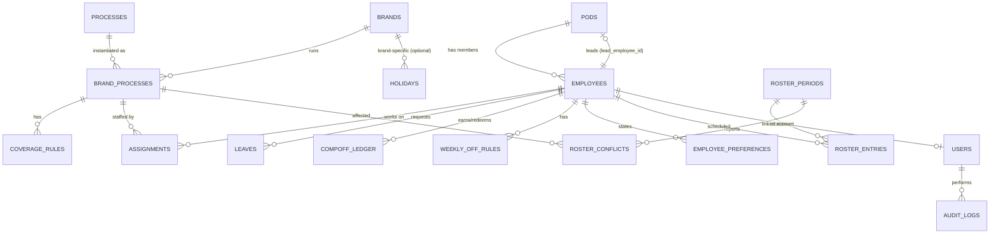

# Database Design (PostgreSQL 16)

> Status: **Frozen v1.0 (Locked 2026-11-01)** · Aligned with confirmed decisions Q1–Q6 & Q11 · Source of truth for SQLAlchemy models and Alembic migrations.

## 1. Modelling principles
- A **brand-process** (a process enabled for a brand) is the unit of coverage and carries the calendar and rules.
- **Assignments** link employees to brand-processes (many-to-many, dated, typed PRIMARY/BACKUP). A single-resource brand and a three-person brand use the same structure.
- **Rules are data**, not code: calendar type, coverage minimums, weekly-off rules are rows.
- **Roster = versioned** (`roster_periods`), entries are per employee-date.
- Soft-delete (`is_active`) where history matters. All tables have `created_at`, `updated_at`.

## 2. ER diagram

## 3. Tables

### pods
| Column | Type | Notes |
|---|---|---|
| id | uuid PK | |
| name | text unique | |
| lead_employee_id | uuid FK→employees, nullable | deferred FK (circular with employees) |
| is_active | bool | |

### employees
| Column | Type | Notes |
|---|---|---|
| id | uuid PK | |
| code | text unique | e.g. EMP-014 |
| full_name | text | |
| email | text unique nullable | |
| pod_id | uuid FK→pods | |
| is_floater | bool default false | can be used as cross-brand backup |
| weekly_off_count | smallint default 1 | per week |
| max_consecutive_days | smallint default 6 | |
| max_concurrent_processes | smallint default 3 | overload threshold |
| joined_on / left_on | date | |
| is_active | bool | |

### processes
`id, name unique (CS, ACC, RET, NDR…), code, description, is_active`

### brands
`id, name unique, code, pod_id (default owning pod, nullable), is_active`

### brand_processes
| Column | Type | Notes |
|---|---|---|
| id | uuid PK | |
| brand_id | FK | |
| process_id | FK | unique(brand_id, process_id) |
| calendar_type | enum | `ALL_365`, `ALL_EXCEPT_HOLIDAYS`, `EXCLUDE_SUNDAY_AND_HOLIDAYS` |
| operating_weekdays | smallint[] nullable | stretch: custom days |
| min_coverage_default | smallint | |
| valid_from / valid_to | date | rule effectivity |
| is_active | bool | |

### coverage_rules
| Column | Type | Notes |
|---|---|---|
| id | uuid PK | |
| brand_process_id | FK | |
| weekday | smallint nullable (0=Mon) | one of weekday/specific_date set |
| specific_date | date nullable | |
| min_staff | smallint | |
| reason | text | |
Check: exactly one of `weekday`, `specific_date` is not null.

### assignments
| Column | Type | Notes |
|---|---|---|
| id | uuid PK | |
| employee_id | FK | |
| brand_process_id | FK | |
| type | enum `PRIMARY`/`BACKUP` | |
| allocation_pct | smallint nullable | informational in v1 |
| valid_from / valid_to | date | |
Unique (employee_id, brand_process_id, valid_from).

### holidays
`id, date, name, brand_id nullable (null = global), is_active` — unique (date, brand_id).

### leaves
| Column | Type | Notes |
|---|---|---|
| id | uuid PK | |
| employee_id | FK | |
| start_date, end_date | date | check end ≥ start |
| type | enum `PLANNED`,`SICK`,`UNPAID`,`COMP_OFF` | |
| status | enum `REQUESTED`,`APPROVED`,`REJECTED`,`CANCELLED` | only APPROVED affects roster |
| note | text | |

### comp_off_ledger
`id, employee_id, entry_date, kind (EARNED/REDEEMED), source_roster_entry_id nullable, status, expires_on nullable` — balance = earned − redeemed.

### weekly_off_rules
`id, employee_id, mode (FIXED_MANDATORY / FIXED_PREFERRED / ROTATING / ANY), weekdays smallint[], valid_from, valid_to`

### employee_preferences
`id, employee_id, kind (PREFERRED_OFF_WEEKDAY / PREFERRED_OFF_DATE / AVOID_WEEKEND_WORK), value jsonb, weight, valid_from, valid_to`

### roster_periods
| Column | Type | Notes |
|---|---|---|
| id | uuid PK | |
| month | date (first of month) | |
| version | int | unique (month, version) |
| status | enum `GENERATING`,`DRAFT`,`PUBLISHED`,`ARCHIVED` | |
| solver_status | text | OPTIMAL / FEASIBLE / FALLBACK |
| generation_params | jsonb | weights, seed, time limit |
| parent_period_id | FK nullable | for versions / alternates |
| is_stale | bool | inputs changed after generation |
| created_by | FK users | |
| published_at | timestamptz | |

### roster_entries
| Column | Type | Notes |
|---|---|---|
| id | uuid PK | |
| roster_period_id | FK | |
| employee_id | FK | |
| date | date | unique (roster_period_id, employee_id, date) |
| shift_id | uuid nullable | FK→shifts (v1 day-level: always null; extensible for shifts) |
| status | enum `WORK`,`WEEKLY_OFF`,`HOLIDAY_OFF`,`HOLIDAY_WORK`,`LEAVE`,`COMP_OFF` | |
| source | enum `AUTO`,`MANUAL`,`LOCKED_FIXED` | |
| is_locked | bool default false | |
| note | text nullable | |

### roster_conflicts
`id, roster_period_id, code, severity, brand_process_id nullable, employee_id nullable, date_from, date_to, root_causes text[], message, suggestions jsonb, is_acknowledged, acknowledged_by, acknowledged_reason, resolved_at`

### users
`id, email unique, password_hash, role (OPS_MANAGER / POD_LEAD / EMPLOYEE), employee_id nullable FK, is_active, last_login_at`

### audit_logs
`id, user_id, action, entity_type, entity_id, before jsonb, after jsonb, created_at`

## 4. Indexes
- `roster_entries (roster_period_id, date)`, `(roster_period_id, employee_id)`
- `assignments (brand_process_id)`, `(employee_id)`
- `leaves (employee_id, start_date, end_date)` where status = APPROVED
- `holidays (date)`
- `roster_conflicts (roster_period_id, severity)`

## 5. Integrity rules
- Only one `PUBLISHED` period per month (partial unique index).
- Deleting employees/brands is soft; FKs use `RESTRICT`.
- Leave overlap for the same employee is rejected at service level.

## 6. Extensibility
- **Shifts** later: add `shifts` table and `shift_id` on `roster_entries`; unique key extends to (employee, date, shift).
- **Regions**: add `region` to holidays and employees.
- **Custom rules**: `rule_definitions` JSONB table consumed by the engine without schema change.
