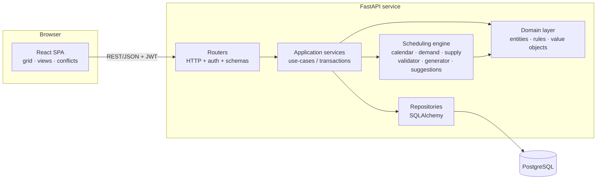
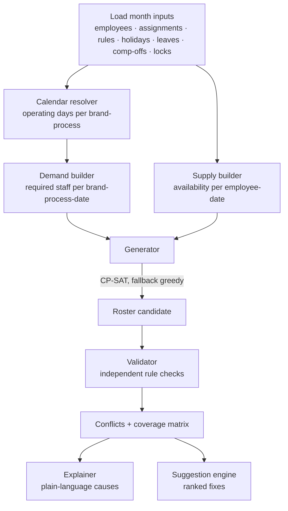

# System Architecture

## 1. Style
A **modular monolith** API (FastAPI) with a layered, clean-architecture structure, a separate React SPA, and PostgreSQL. No microservices — the scale (tens of employees, hundreds at most) doesn't justify them.

## 2. Component diagram

## 3. Layers and rules

| Layer | Responsibility | May depend on |
|---|---|---|
| **api/** (routers, schemas) | HTTP, authN/Z, DTOs, error mapping | services |
| **services/** | Use-cases: "generate roster", "apply leave", "publish"; transaction boundaries; audit logging | domain, engine, repositories |
| **scheduler/** (engine) | **Pure Python, no DB or HTTP.** Takes plain dataclasses in, returns plain dataclasses out | domain only |
| **domain/** | Enums, value objects, dataclasses (`DemandCell`, `RosterCell`, `Conflict`) | nothing |
| **repositories/** | Persistence, query building | models |
| **models/** | SQLAlchemy ORM | – |

The engine being a pure function of its input is the key design choice: it is trivially unit-testable, deterministic, and reusable by a CLI or worker later.

## 4. Scheduling engine pipeline

Details in `SCHEDULING_ENGINE.md`.

## 5. Key data flows

### 5.1 Generate roster
1. `POST /rosters {month}` → service loads inputs (one query batch).
2. Engine resolves calendars → demand; builds supply; solves; validates.
3. Service persists `roster_period` (DRAFT), `roster_entries`, `roster_conflicts`, writes audit entry.
4. Response returns roster id, summary counts, and conflict list; grid data fetched via view endpoints.

### 5.2 Edit a cell (live validation)
1. `POST /rosters/{id}/impact` with the proposed change (dry run — nothing saved).
2. Engine re-validates only the affected dates/brand-processes and diffs conflicts: *new*, *resolved*, *unchanged*.
3. UI shows the diff; on confirm, `PUT /rosters/{id}/entries` persists, re-stores conflicts, audits.

### 5.3 Change after generation (e.g. new leave)
1. Leave saved → service flags rosters covering those dates as **stale** for the affected employee/dates.
2. Impact computed as above; suggestion engine proposes fixes (floater, weekly-off swap, comp-off shift, re-assign).
3. Manager applies a suggestion or runs **local repair** (solver with all unaffected cells locked).

### 5.4 Publish
Validation must show **zero BLOCKING conflicts** (or manager explicitly acknowledges listed ones with a reason) → status PUBLISHED, version frozen. Later edits create version n+1 as DRAFT.

## 6. Concurrency and long-running work
- Solver time limit (default 20 s) enforced; runs in a thread via `run_in_threadpool`.
- One active generation per month (advisory lock / status check) to avoid double solves.
- If solves ever exceed limits: move to a background worker with a polling endpoint — API contract already uses a roster `status` field to allow this.

## 7. Error handling
Domain errors → typed exceptions → mapped to a uniform JSON error (see `API_DOCUMENTATION.md`). Engine never raises for "infeasible"; it returns shortfalls.

## 8. Scaling notes (README Q7)
- Solve per **pod or connected component** of the assignment graph rather than company-wide when the team doubles — independent sub-problems solve in parallel.
- Pre-computed demand/supply matrices cached per month.
- Add a job queue and read replicas only when measured need appears.

## 9. Cross-cutting
Structured JSON logging with request ids; `/health` and `/ready`; settings via environment; audit log written in the service layer, not routers.
