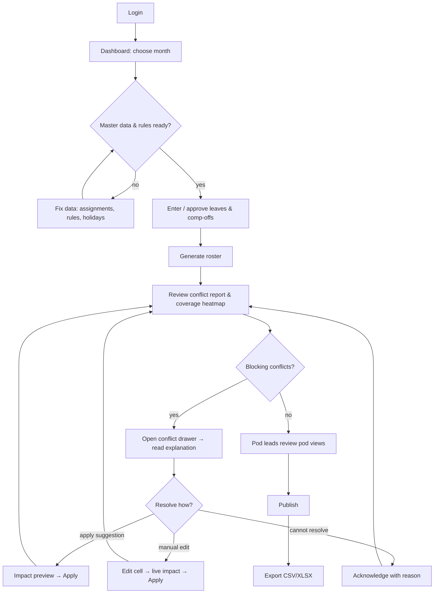
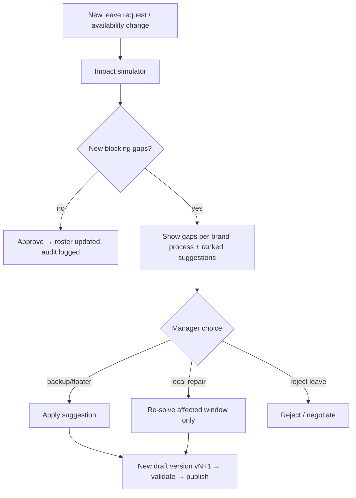

# User Flows

## 1. Roles and permissions

| Capability | Ops Manager | Pod Lead | Employee |
|---|---|---|---|
| Manage master data | ✔ | own pod only | – |
| Manage rules/holidays | ✔ | read | – |
| Enter/approve leave | ✔ | recommend for own pod | request own (stretch) |
| Generate / edit roster | ✔ | edit own pod cells (draft) | – |
| Publish roster | ✔ | – | – |
| Acknowledge blocking conflicts | ✔ | – | – |
| View company roster | ✔ | ✔ | – |
| View own roster | ✔ | ✔ | ✔ |
| Settings, users, audit | ✔ | – | – |

## 2. Primary journey — monthly planning (Ops Manager)

## 3. Change-after-publish journey

## 4. Journey: single-resource brand
1. Manager opens **Brand view → Aurora**.
2. Sees one employee, process rows CS/ACC/NDR, a ⚠ **single point of failure** badge.
3. Adds leave 13–15 Dec (Sun–Tue) in the simulator → red gaps on CS and ACC for all three days (both operate on Sunday) and on NDR only for Mon–Tue (NDR is closed on Sundays).
4. Drawer lists backups (floater Kabir: free on those days; fixes 3, opens 0).
5. Applies → Kabir shows as covering; audit entry records who/why.

## 5. Journey: three-person brand
1. Brand view → Nova: three employees (CS, ACC, NDR).
2. One goes on leave → matrix "remaining two vs demand per day" shows days still covered (green) and days not (red) with cause.
3. Manager reallocates a process temporarily or swaps a weekly off.

## 6. Journey: Pod Lead
Login → Roster (pod view locked to own pod) → review days/conflicts for team → comment/suggest edits (draft) → Ops Manager publishes.

## 7. Journey: Employee
Login → My Roster → sees statuses, holidays, comp-off balance → (stretch) request leave.

## 8. Navigation rules
- Month and view selection persist in the URL (`/roster?month=2026-12&view=brand&ref=aurora`) so links can be shared.
- Conflicts deep-link into the grid scrolled to the affected cell.
- Browser back returns to the previous view state.
- Unsaved edits prompt before leaving.

## 9. Error and edge flows
| Situation | Behaviour |
|---|---|
| Generation exceeds time limit | Show best-so-far roster labelled "time-limited" with conflicts |
| Solver unavailable | Fallback generator, banner explains |
| Edit on published roster | Creates new draft version; original untouched |
| Concurrent edit | 409 → "Roster changed by Priya at 10:42 — reload" |
| Session expired | Silent refresh once, else redirect to login preserving the route |
